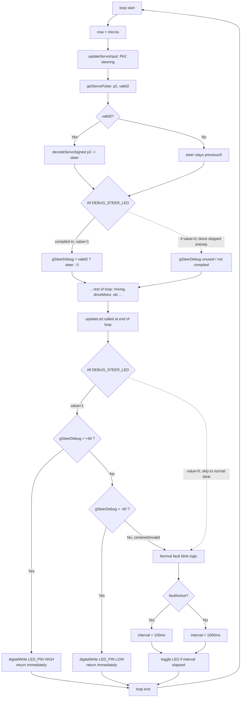
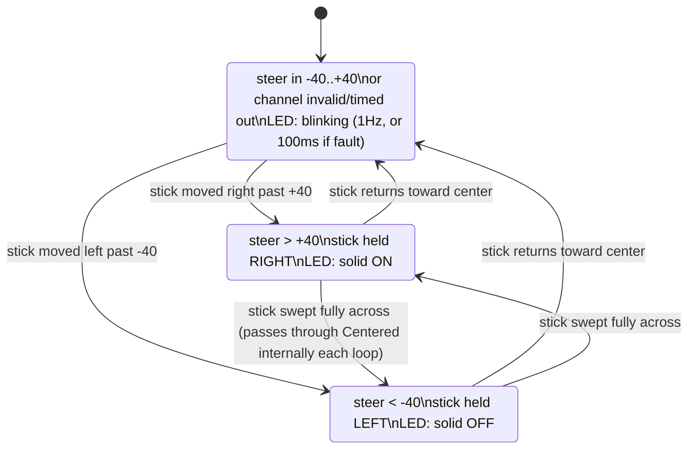

# DEBUG_STEER_LED — How It Works

## Flowchart

## State Diagram — what the LED shows for each steering position

## What each outcome tells you

| Observation while moving steering stick | Meaning |
|---|---|
| LED snaps solid ON at right, solid OFF at left | `PA2` capture + decode works correctly - bug must be elsewhere (unlikely given motor side already verified) |
| LED just keeps blinking no matter what | `gSteerDebug` never leaves -40..+40 - PA2 isn't producing a valid, wide-swinging pulse (wiring / receiver channel / endpoint travel problem) |
| LED flickers erratically | Noisy/intermittent signal on PA2 |

