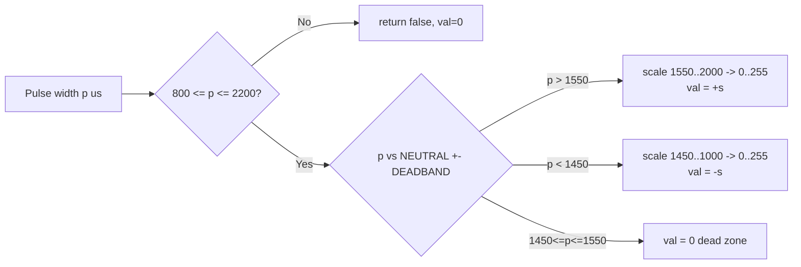
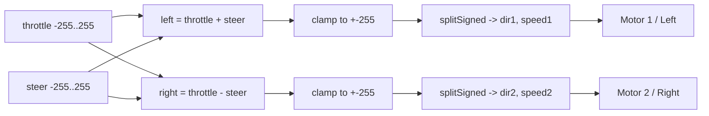

# Servo Motor Controller — Code Flow

## Overview
Non-blocking dual-channel RC PWM reader that mixes throttle + steering into
differential-drive commands for two DC motors, with current/voltage fault
protection and status LED.

## Flowchart

```mermaid
flowchart TD
    A[setup] --> A1[Configure pins:\nSERVO_IN_1/2 = INPUT\nMotor pins, INH, LED = OUTPUT]
    A1 --> A2[INH = LOW, LED = LOW\nStop both motors]
    A2 --> A3[Init previousLevel for edge detection]
    A3 --> B[loop]

    B --> C[now = micros]
    C --> D1[updateServoInput: Throttle PA1]
    C --> D2[updateServoInput: Steering PA2]

    D1 --> D1a{Rising edge?}
    D1a -->|Yes| D1b[riseTime = now]
    D1a -->|No, Falling edge| D1c{width in\nVALID_MIN..MAX?}
    D1c -->|Yes| D1d[pulseWidth = width\nhavePulse = true]
    D1c -->|No| D1e[discard]

    D2 --> D2a{Rising/Falling edge?}
    D2a --> D2b[same logic as throttle]

    D1d --> E
    D1e --> E
    D2b --> E[now = micros again]

    E --> F1[getServoPulse: throttle\nvalid1, p1]
    E --> F2[getServoPulse: steering\nvalid2, p2]

    F1 --> G1{valid1?}
    G1 -->|Yes| G1a[decodeServoSigned p1 -> throttle]
    F2 --> G2{valid2?}
    G2 -->|Yes| G2a[decodeServoSigned p2 -> steer]

    G1a --> H{MIX_MODE?}
    G2a --> H

    H -->|0: Independent| I1[Invalid channel -> 0\nsplitSigned(throttle)->dir1,speed1\nsplitSigned(steer)->dir2,speed2\ndriversOn = valid1 && valid2]
    H -->|1: Mixing default| I2[Invalid throttle -> throttle=0,steer=0\nInvalid steer -> steer=0\nleft = throttle+steer\nright = throttle-steer\nclamp +-255\nsplitSigned(left)->dir1,speed1\nsplitSigned(right)->dir2,speed2\ndriversOn = valid1]

    I1 --> J[checkFault: read IS1-IS4 / VSENSE]
    I2 --> J

    J --> K{fault detected?}
    K -->|Yes| K1[badCount++ up to FAULT_CONFIRM]
    K -->|No| K2[badCount = 0]
    K1 --> L{badCount >= FAULT_CONFIRM?}
    K2 --> L
    L --> M[faultActive = result]

    M --> N{FAULT_SHUTDOWN\nand faultActive?}
    N -->|Yes| N1[Force dir1/2=0, speed1/2=0\ndriversOn = false]
    N -->|No| O
    N1 --> O[driveMotor M1_A/M1_B, dir1, speed1]
    O --> O2[driveMotor M2_A/M2_B, dir2, speed2]
    O2 --> P[INH = driversOn ? HIGH : LOW]
    P --> Q[updateLed:\nblink interval = fault?100ms:1000ms]
    Q --> B
```

## Signal Decode Detail



## Mixing Logic (MIX_MODE = 1, default)



